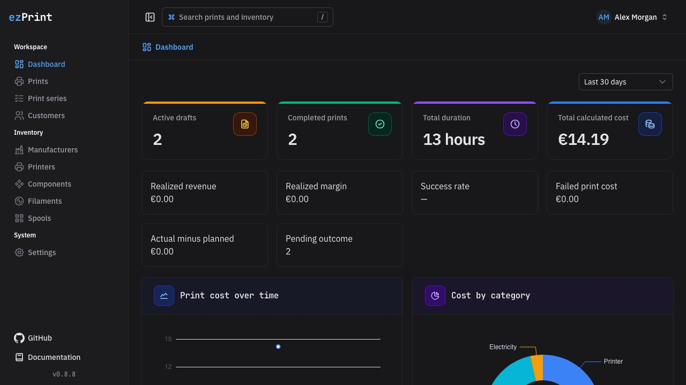
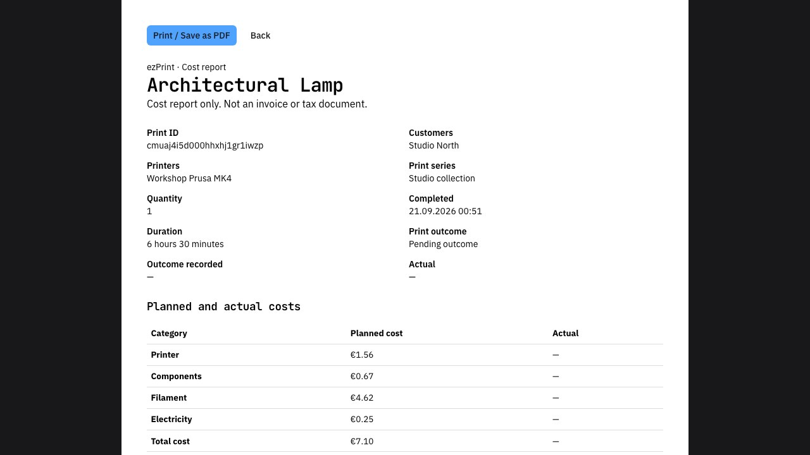
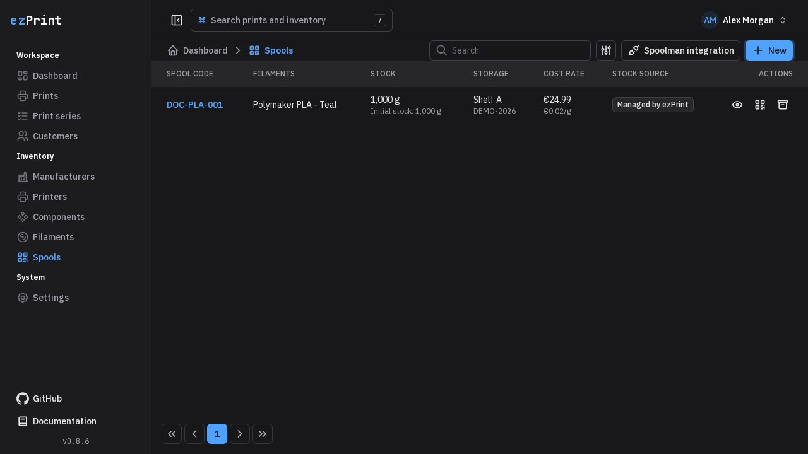
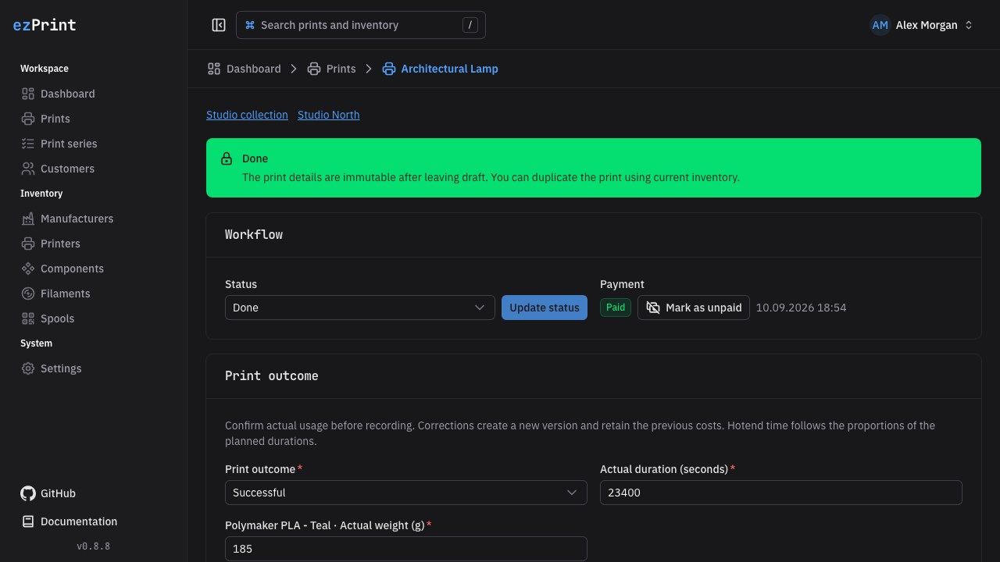

# 🖨️ ezPrint <!-- omit in toc -->

[](https://www.buymeacoffee.com/tobiaswaelde)
[](https://github.com/tobiaswaelde/ezprint/actions/workflows/ci.yml)
[](https://tobiaswaelde.github.io/ezprint/)
[](https://github.com/tobiaswaelde/ezprint/actions/workflows/release.yml)

A self-hosted Nuxt application for transparent, reproducible filament-print cost calculation. It combines master
data, live draft calculations, immutable completion snapshots, and an operator-friendly dashboard in one bilingual
interface.

## ✨ Highlights

- Calculate printer, component, filament, and electricity costs with decimal arithmetic.
- Keep completed calculations reproducible through immutable, versioned snapshots.
- Manage customers, printers, components, filaments, and draft print jobs from a responsive UI.
- Find prints and inventory through the global application search.
- Explore and try the complete HTTP API through the built-in Scalar reference at `/api-reference`.
- Run the application as a single container with SQLite persistence, migrations, and a health check.
- Use the complete US English [documentation website](https://tobiaswaelde.github.io/ezprint/), including screenshots for every application page.

## 📚 Table of Contents <!-- omit in toc -->

- [✨ Highlights](#-highlights)
- [📸 Screenshots](#-screenshots)
- [🐳 Run with Docker Compose](#-run-with-docker-compose)
- [🛠️ Local development](#-local-development)
- [🔒 Security](#-security)

## 📸 Screenshots

| Dashboard                                                                                | Cost report                                                                                     |
| ---------------------------------------------------------------------------------------- | ----------------------------------------------------------------------------------------------- |
|  |         |
| Spool inventory                                                                          | Completed print                                                                                 |
|          |  |

## 🐳 Run with Docker Compose

Copy [`compose.example.yml`](./compose.example.yml) to `compose.yml`, pin the image to a released version, and start
the service:

```bash
cp compose.example.yml compose.yml
docker compose pull
docker compose up -d
curl --fail http://127.0.0.1:3000/api/health
```

Open `http://localhost:3000` and create the first operator account in the guided setup. Production installations
should use TLS, restrict network access to the application, and regularly back up the persistent volume.

> [!IMPORTANT]
> The application supports one running replica. SQLite is a single-writer database and the setup lock is local to
> the application process.

Detailed instructions cover [deployment](https://tobiaswaelde.github.io/ezprint/operations/deployment),
[backup and restore](https://tobiaswaelde.github.io/ezprint/operations/backup-restore), and
[upgrades](https://tobiaswaelde.github.io/ezprint/operations/upgrades).

## 🛠️ Local development

Node.js 24 and the Corepack-provided pnpm version from `packageManager` are required.

```bash
corepack enable
cp .env.example .env
pnpm install
pnpm db:migrate
pnpm db:seed -- --email demo@example.test --password 'local-demo-password-123'
pnpm dev
```

The optional seed command creates a complete synthetic demonstration dataset in an otherwise empty development
database. It refuses production environments and databases that already contain application data.

Open `http://localhost:3000/api-reference` for the interactive Scalar documentation, or load the repository's
`bruno/` collection and select its `Local` environment. The OpenAPI 3.1 document is available at
`http://localhost:3000/api/openapi.json`.

Run the main verification suite before committing:

```bash
pnpm format:check
pnpm lint
pnpm i18n:check
pnpm typecheck
pnpm test
pnpm build
pnpm test:integration
pnpm test:e2e
pnpm docs:screenshots && pnpm docs:check && pnpm docs:build && pnpm test:docs:e2e
```

See the [contribution guide](https://tobiaswaelde.github.io/ezprint/development/contributing) for
Changesets, migrations, documentation standards, and the full container verification.

## 🔒 Security

Please report vulnerabilities privately through GitHub. Do not open a public issue for an unpatched vulnerability;
follow the repository [security policy](./SECURITY.md) instead.

## Development toolchain

Use Node.js 26.13.0 LTS and the package manager pinned in `package.json`. Node-based application runtimes require Node.js 26. Builds use TypeScript 7; ESLint and compiler-API consumers use the TypeScript 6 compatibility package. Dependency overrides, where present, pin security fixes for transitive packages; validate tests and documentation builds when changing them.
